皆様、こんにちは。Configuration Manager / WSUS サポート チームです。

今回は、Configuration Manager のパッケージ展開について、パッケージとプログラムの作成から、配布ポイントへのコンテンツ配布、クライアントでのダウンロードとプログラム実行までを説明します。必須展開による自動実行と、利用可能な展開をソフトウェア センターから手動実行する場合の違いを、ログと対応付けて確認します。

アプリケーション モデルの検出方法、タスク シーケンス、サイト間のコンテンツ転送、プル配布ポイント、および配布ポイントからの直接実行は対象外です。

## 全体の流れ

1. パッケージとプログラムを作成し、パッケージ ソースのコンテンツをサイト サーバーへ取り込みます。
2. 対象の配布ポイントへコンテンツを配布します。
3. コレクションへプログラムを展開し、展開ポリシーを生成します。
4. クライアントがポリシーを取得し、対象のプログラムを認識します。
5. 必須展開の割り当てスケジュール、またはソフトウェア センターの操作によって実行が要求されます。
6. クライアントがコンテンツの場所を取得し、キャッシュへダウンロードします。
7. クライアントがプログラムを実行し、終了コードと実行結果を記録します。

この番号は説明の区切りです。コンテンツの取得と実行要求の処理は前後・並行する場合があります。後述の必須展開では、コンテンツ取得要求の後に必須実行要求が記録され、ダウンロード完了後にプログラムが実行されています。

## 動作説明の前提

パッケージはコンテンツをまとめる単位、プログラムは実行するコマンド ラインや実行条件を定義する単位です。パッケージにソース ファイルを含める場合は、そのコンテンツを配布ポイントへ配布します。コンテンツの配布と、コレクションへのプログラムの展開は別の操作です。

本記事では、次の構成を扱います。

| 項目 | 説明対象 |
| --- | --- |
| サーバー構成 | プライマリ サイト サーバーと通常の配布ポイントを同一サーバーに配置 |
| パッケージ | ソース ファイルを含むパッケージと標準プログラム |
| クライアントの動作 | コンテンツをダウンロードし、ローカルでプログラムを実行 |
| プログラム | `cmd.exe /c SampleScript.cmd` を管理者権限で実行。ユーザーのログオン状態に関係なく実行可能 |
| 必須展開 | 割り当てスケジュールによる自動実行 |
| 利用可能な展開 | ソフトウェア センターから手動実行 |

必須展開と手動実行には、それぞれ別のクライアントを使用しています。掲載するログのキャッシュ パスやジョブ ID は各実行の値であり、環境や実行ごとに異なります。

必須展開は設定したスケジュールに従って自動実行されますが、実際の開始にはポリシー取得、コンテンツの準備、プログラムの実行条件、メンテナンス期間などが関係します。利用可能な展開では、ユーザーがソフトウェア センターから実行を開始します。必須展開でも設定によっては期限前の手動実行が可能であるため、ソフトウェア センターで実行できることだけで展開の目的は区別できません。

## 各ステップとログの追跡方法

### 関連ログ

| ログ名 | 保存場所 | 主な用途 |
| --- | --- | --- |
| SMSProv.log | SMS Provider を配置したサーバーの Configuration Manager ログ フォルダー | コンソールからのパッケージ、プログラム、展開に対する操作 |
| smsdbmon.log | サイト サーバーの Configuration Manager インストール先の Logs フォルダー | データベースの変更に伴うコンポーネントへの通知 |
| distmgr.log | 同上 | パッケージ ソースの取り込み、配布ポイントへの配布、配布状態 |
| offermgr.log | 同上 | 展開の作成・更新 |
| PolicyPV.log | 同上 | 展開に対応するポリシーとポリシー割り当ての生成 |
| PolicyAgent.log | クライアントの %windir%\CCM\Logs | ポリシーの要求と取得 |
| PolicyEvaluator.log | 同上 | 取得したポリシーの評価 |
| Scheduler.log | 同上 | スケジュールの登録、起動、および実行コンポーネントへの通知 |
| execmgr.log | 同上 | パッケージとプログラムの認識、実行要求、コンテンツ待機、コマンド実行、実行結果 |
| LocationServices.log | 同上 | コンテンツ取得先となる配布ポイントの検索 |
| CAS.log | 同上 | コンテンツ要求、キャッシュの確認と管理 |
| ContentTransferManager.log | 同上 | コンテンツ転送ジョブと取得先の管理 |
| DataTransferService.log | 同上 | Background Intelligent Transfer Service (BITS) を使用した転送 |
| StatusAgent.log | 同上 | クライアント コンポーネントが生成するステータス メッセージ |
| SCClient のログ | 同上。ファイル名にはユーザーを識別する情報を含む | ソフトウェア センターの操作 |

本記事のログはサイト サーバーと配布ポイントが同居する構成のものです。PkgXferMgr.log はプライマリ サイトからリモート配布ポイントへの転送を確認するログであり、本記事の配布処理をそのままリモート配布ポイントの転送手順に置き換えることはできません。

### テスト展開の情報

| 項目 | 値 |
| --- | --- |
| パッケージ名 | Sample Package |
| Package ID | PS10009D |
| ソース バージョン | 1 |
| プログラム名 | Run Sample Script |
| 必須展開のコレクション | Test Package Required |
| 必須展開の展開 ID | PS120009 |
| 利用可能な展開のコレクション | Test Package Available |
| 利用可能な展開の展開 ID | PS12000A |

ログでは展開 ID が Advertisement ID、advert、offer などとして記録されます。Package ID だけでは同じパッケージの複数の展開を区別できないため、展開 ID とプログラム名も併せて確認します。

以下は実際の Configuration Manager 環境で確認したメッセージ本文の抜粋です。各行の日時は除外し、サーバー名とドメイン名は匿名化しています。途中の行を省略した箇所は「... (中略) ...」で示します。ログ間の対応付けに使用する Package ID、展開 ID、およびジョブ ID は維持しています。

画面キャプチャのソース パスと配布ポイント名に含まれるサーバー名は、&lt;SiteServer&gt; に置き換えています。また、環境名が表示されるコンソールのタイトルバーは切り取っています。

### ステップ 1 : パッケージとプログラムの作成

1. コンソールの [ソフトウェア ライブラリ] > [アプリケーション管理] > [パッケージ] から [パッケージの作成] を選択します。[名前] に Sample Package を入力し、[このパッケージにソース ファイルを含める] を選択して、SampleScript.cmd を格納したソース フォルダーを指定します。

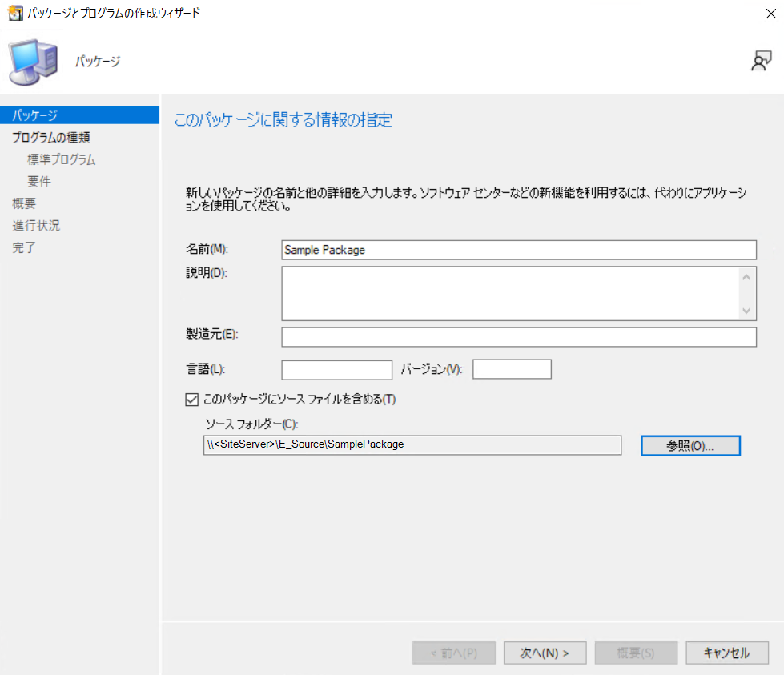

2. [プログラムの種類] で [標準プログラム] を選択します。

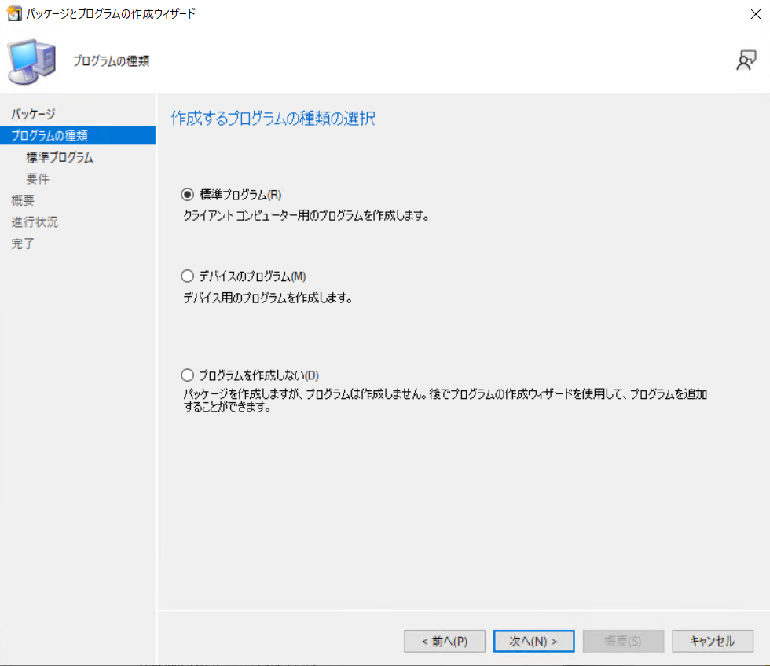

3. プログラム名に Run Sample Script、コマンド ラインに `cmd.exe /c SampleScript.cmd` を指定します。[プログラムの実行条件] は [ユーザーのログオン状態に関係なし]、[実行モード] は [管理者権限で実行する] とします。

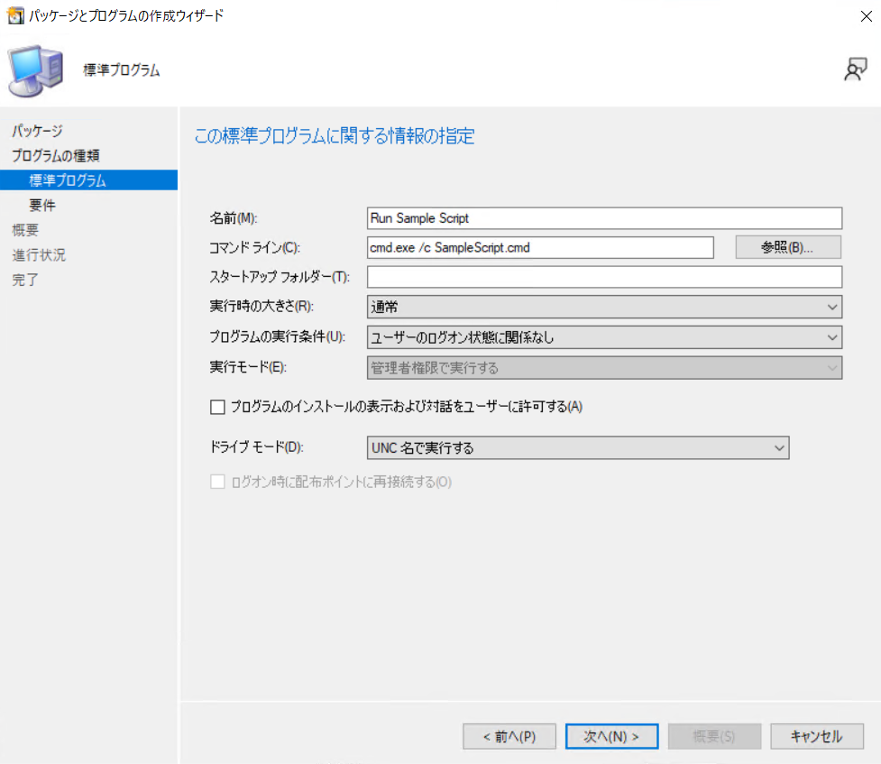

4. [要件] を確認し、[概要] から作成を完了します。この例ではプラットフォームを限定せず、[最大許容実行時間] は 120 分です。実際のプログラムに合わせて設定します。

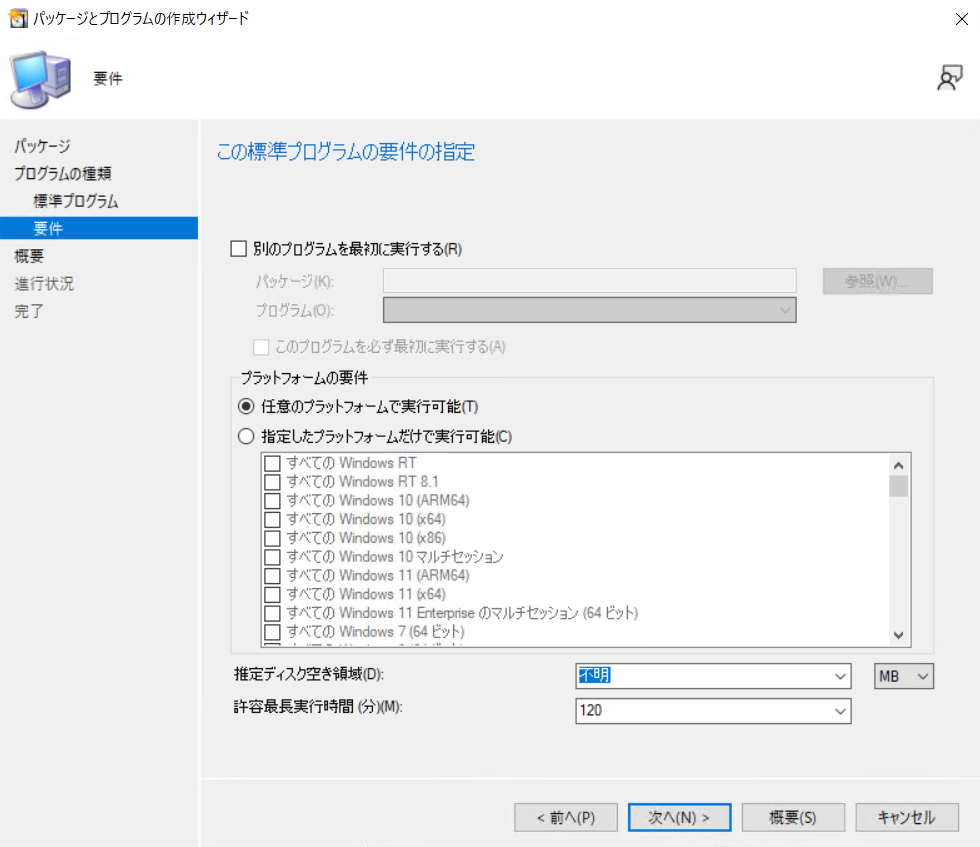

コンソールからパッケージとプログラムを作成すると、SMS Provider を通じて情報が登録されます。データベースの変更を受けて Distribution Manager がパッケージを処理します。作成操作を確認する場合は SMSProv.log、処理開始の通知を確認する場合は smsdbmon.log を使用します。

distmgr.log では、Package ID を検索して処理の開始、ソースのスナップショット作成、およびパッケージの作成・更新を確認します。

```text
Found package properties updated notification for package 'PS10009D'
Adding package 'PS10009D' to package processing queue.
... (中略) ...
~Successfully created/updated the package PS10009D
```

パッケージの処理成功を示すステータス メッセージ ID 2301 も記録されています。ただし、この段階でパッケージが処理されたことと、配布ポイントへの配布完了は別です。

ソースの取り込みが完了していない場合は、同じ Package ID の前後に記録されたエラーと、サイト サーバーのコンピューター アカウントがソース フォルダーを読み取れるかを確認します。

### ステップ 2 : 配布ポイントへのコンテンツ配布

1. [パッケージ] で Sample Package を右クリックし、[コンテンツの配布] を選択します。

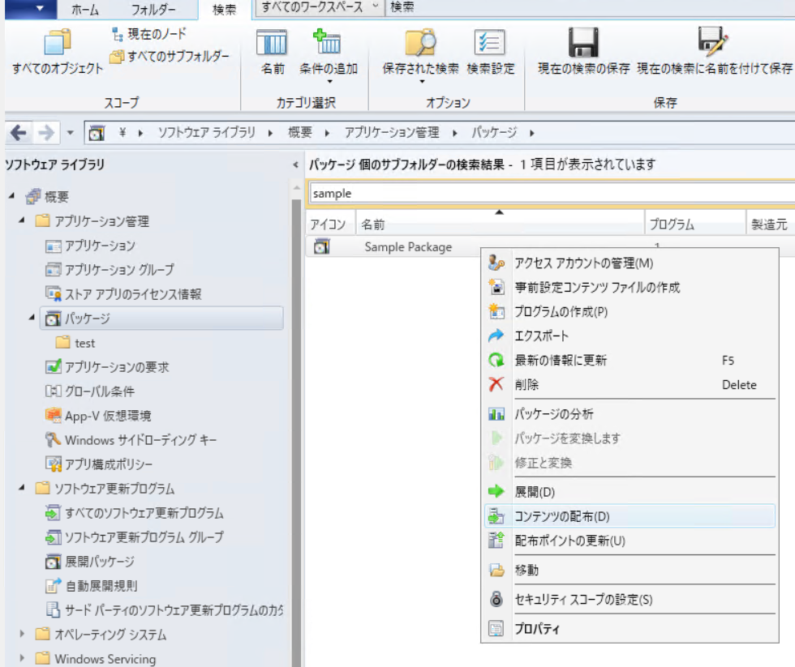

2. ウィザードの [コンテンツの配布先] で [追加] から配布ポイントを指定し、配布先に追加されたことを確認してウィザードを完了します。この例では、サイト サーバーと同居する配布ポイントを選択しています。

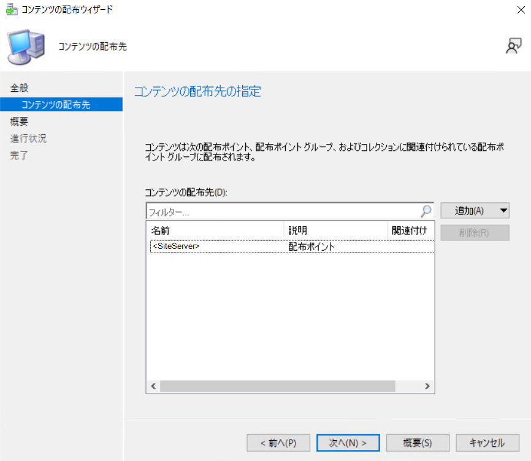

コンテンツを配布する配布ポイントを指定すると、Distribution Manager が対象の配布ポイントに対する処理を開始します。今回のようにサイト サーバーと配布ポイントが同居する場合も、パッケージの作成と配布ポイントに対する処理は区別して確認します。

distmgr.log には、次の記録があります。

```text
Start adding package PS10009D to server ["Display=\\<SiteServer>\"]MSWNET:["SMS_SITE=PS1"]\\<SiteServer>\...
... (中略) ...
DP Thread: Attempting to add or update package PS10009D on DP ["Display=\\<SiteServer>\"]MSWNET:["SMS_SITE=PS1"]\\<SiteServer>\
```

続いて、同じ Package ID と配布ポイントに対して、配布成功を示すステータス メッセージ ID 2330 が記録されています。コンソールの [監視] から [配布ステータス] > [コンテンツのステータス] を開き、対象コンテンツの配布状態と照合します。

3. Sample Package を開き、配布結果を確認します。次の画面では [成功: 1] となっています。配布ウィザードの完了は配布操作の受け付けであるため、この状態表示とログで配布完了を確認します。

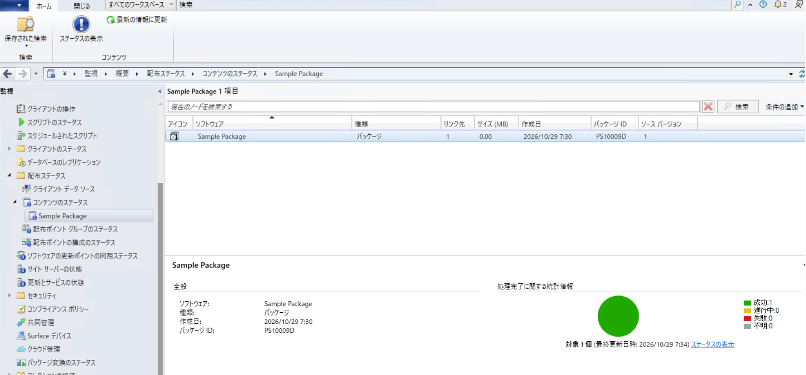

処理スレッドの終了だけでなく、対象の配布ポイントへの配布結果まで確認することがポイントです。配布が完了しない場合は、Package ID と対象の配布ポイントをキーに distmgr.log の処理結果を追跡します。

### ステップ 3 : 展開とポリシー生成

Sample Package の [展開] からソフトウェアの展開ウィザードを開き、Run Sample Script を対象コレクションへ展開します。ここでは、次の 2 つの展開をそれぞれ作成します。

1. 自動実行用の展開では、[全般] でコレクションに Test Package Required を指定します。

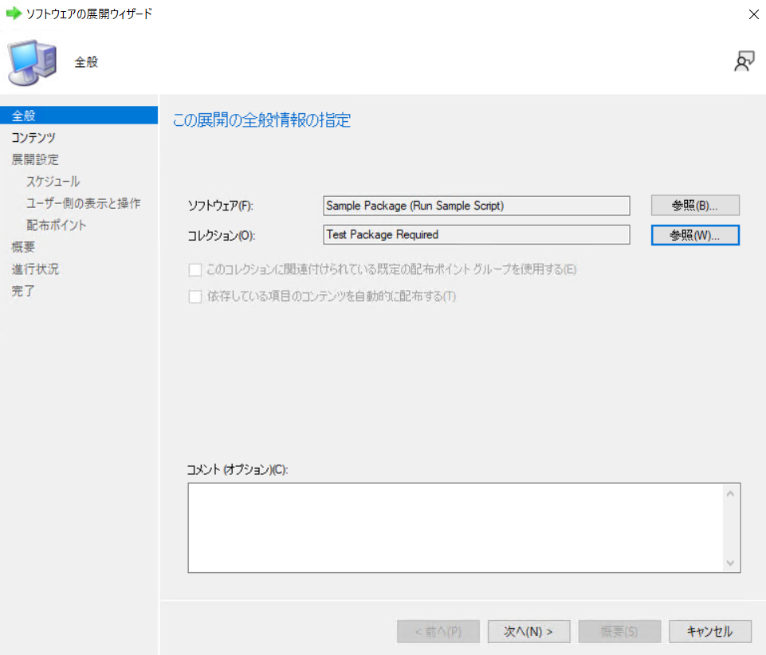

[展開設定] の [目的] は [必須] を選択します。

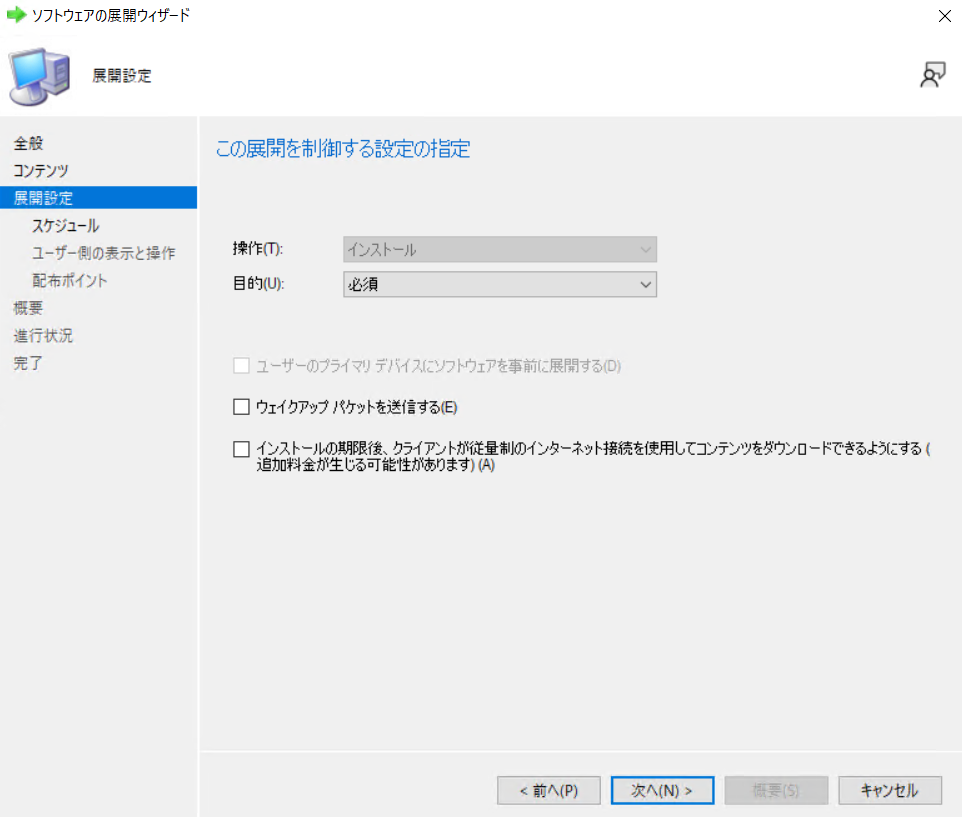

2. 手動実行用の展開では、コレクションに Test Package Available を指定します。

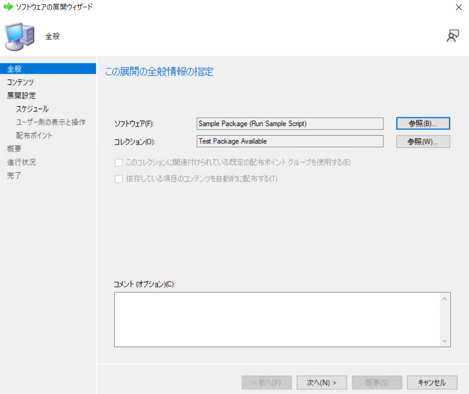

[展開設定] の [目的] は [利用可能] を選択します。

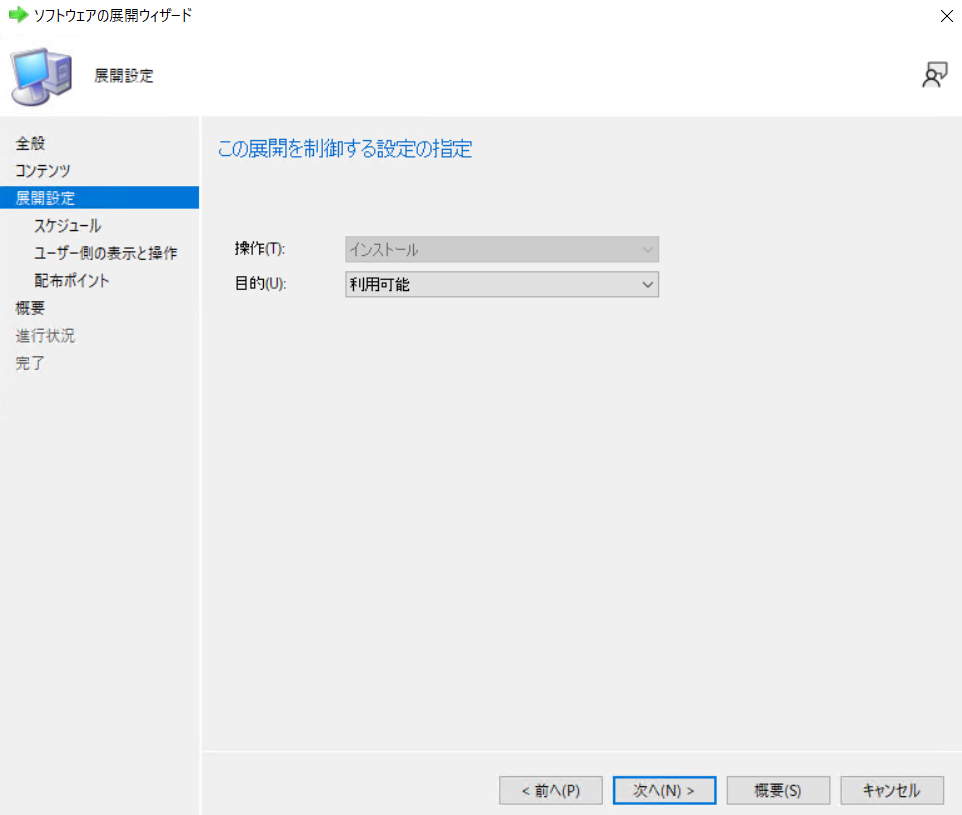

スケジュールと配布ポイントの設定は、後述のステップ 5 とステップ 6 の画面に対応します。これらを設定し、[概要] で内容を確認してウィザードを完了します。

パッケージ内のプログラムをコレクションへ展開すると、offermgr.log に展開の処理が記録されます。

```text
~Processing New offer PS120009
... (中略) ...
~Processing New offer PS12000A
```

続いて PolicyPV.log で、それぞれの展開に対するポリシーと割り当ての作成を確認します。

```text
~Successfully created policy PS120009-PS10009D-099642BA and policy assignment {ed4e6ad5-7fea-4c4f-8248-3be14a868a38} based on package PS10009D, program Run Sample Script and offer PS120009
... (中略) ...
~Successfully created policy PS12000A-PS10009D-099642BA and policy assignment {c9ef304e-7b62-496c-bc8a-bf6a8158f219} based on package PS10009D, program Run Sample Script and offer PS12000A
```

この例では、必須展開の Policy ID は PS120009-PS10009D-099642BA、利用可能な展開の Policy ID は PS12000A-PS10009D-099642BA です。次のクライアント側の確認でも、この値を使用します。Policy ID の末尾の値を固定値として扱う必要はありません。

展開がクライアントで認識されない場合は、まずコンソールの対象コレクションとメンバーシップを確認し、PolicyPV.log で対象の展開 ID に対するポリシー生成を確認します。

### ステップ 4 : クライアントでのポリシー取得とプログラムの認識

このステップのポリシー取得と評価は、クライアント側で処理されます。ユーザーがプログラムの実行を開始する操作とは別です。

利用可能な展開の確認では、ソフトウェア センターを開き、[Applications] から [Sample Package - Run Sample Script] を選択します。次の画面は、対象プログラムが表示され、状態が [Available] となった状態です。この時点では、まだ [Install] は選択していません。

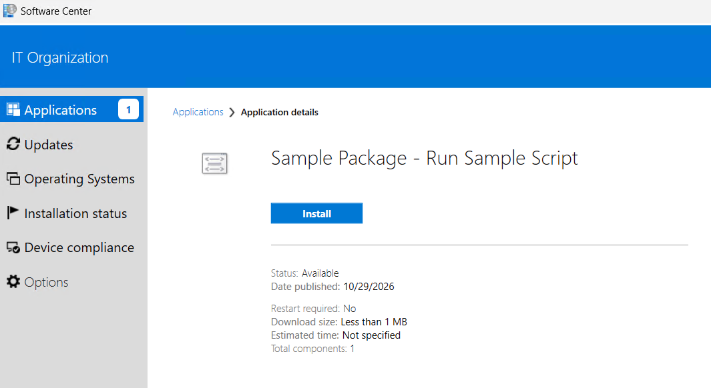

クライアントは管理ポイントからポリシーを取得します。PolicyAgent.log で前のステップの Policy ID を検索し、取得処理を追跡します。PolicyEvaluator.log は取得したポリシーの評価を確認するために使用します。

対象のポリシーを取得した後、execmgr.log に次のメッセージが記録されています。

必須展開のクライアント:

```text
OnPolicyActivation package PS10009D program Run Sample Script
... (中略) ...
Policy arrived for parent package PS10009D program Run Sample Script
```

利用可能な展開のクライアント:

```text
OnPolicyActivation package PS10009D program Run Sample Script
... (中略) ...
Policy arrived for parent package PS10009D program Run Sample Script
```

これらはプログラムのポリシーが認識されたことを示します。実行完了を示すメッセージではないため、続けて実行要求とコンテンツの準備状況を確認します。

対象のプログラムが認識されない場合は、PolicyAgent.log で対象の Policy ID の取得状況を確認し、その後の評価と execmgr.log の記録を確認します。

### ステップ 5 : 必須展開と手動実行の開始

必須展開では、展開ウィザードの [スケジュール] で割り当てスケジュールに [直ちに] を設定しています。[この展開が使用可能になる日時を指定する] は未選択です。画面内の無効な日時欄ではなく、割り当てスケジュールの設定を確認します。実際の実行開始には、ポリシーとコンテンツの準備、および実行条件が関係します。

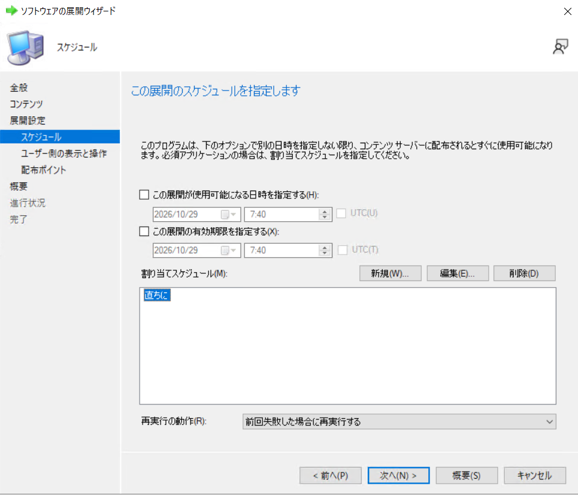

必須展開では、Scheduler.log にスケジュールから実行コンポーネントへの通知が記録されています。

```text
Sending message for schedule 'Machine/PS120009-PS10009D-099642BA' (Target: 'direct:execmgr', Name: '')
```

execmgr.log では、展開 ID PS120009 に対する必須実行要求を確認できます。

```text
Mandatory execution requested for program Run Sample Script and advertisement PS120009
Creating mandatory request for advert PS120009, program Run Sample Script, package PS10009D
```

一方、利用可能な展開では、ソフトウェア センターで対象プログラムの [インストール] を選択すると、execmgr.log に任意実行要求が記録されます。

手動実行では、ステップ 4 の画面で [Install] を選択します。クライアントの画面は英語表示ですが、日本語表示の [インストール] に対応する操作です。

```text
OnOptionalExecutionRequests attempted for package PS10009D optional program Run Sample Script [QueueRequest: false RunOnCompletion : true QuietMode: true SDKCallerId: (null)]
```

このメッセージの後に、展開 ID PS12000A に対応するプログラムの取得と実行を追跡できます。操作側の状況を詳しく確認する場合は、ソフトウェア センターの SCClient ログも併せて確認します。

必須展開で開始しない場合は、割り当てスケジュールに加え、プログラムのログオン条件、最大許容実行時間、メンテナンス期間、および過去の実行に対する再実行設定を確認します。利用可能な展開では、ポリシーの認識とユーザーによる実行操作を分けて確認します。

### ステップ 6 : コンテンツの場所の取得とダウンロード

展開ウィザードの [配布ポイント] では、現在の境界グループに対する [展開オプション] に [配布ポイントからコンテンツをダウンロードしてローカルで実行する] を選択しています。必須展開と利用可能な展開で同じ設定です。近隣または既定の境界グループに対しては [プログラムを実行しない] を選択しています。

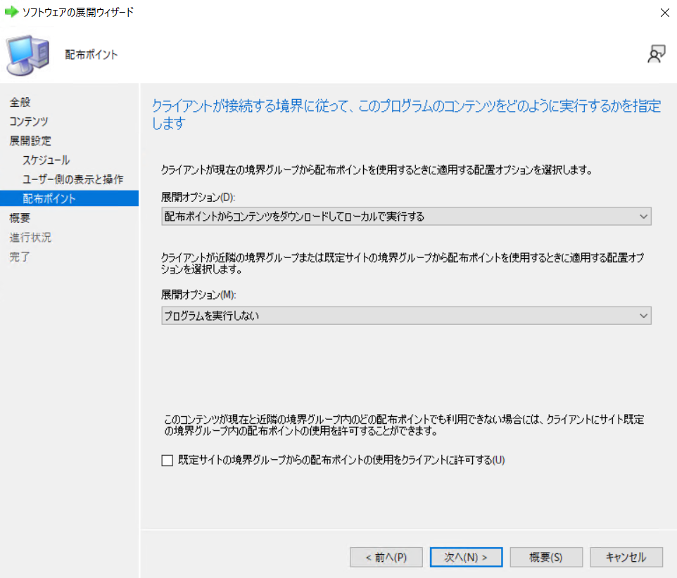

クライアント側で、ファイルを手動でコピーする操作は行いません。次の画面は、ソフトウェア センターから手動実行を開始した後の状態です。[Downloading (100% complete)] と表示されていますが、プログラムの実行完了は後述のステップ 7 で確認します。

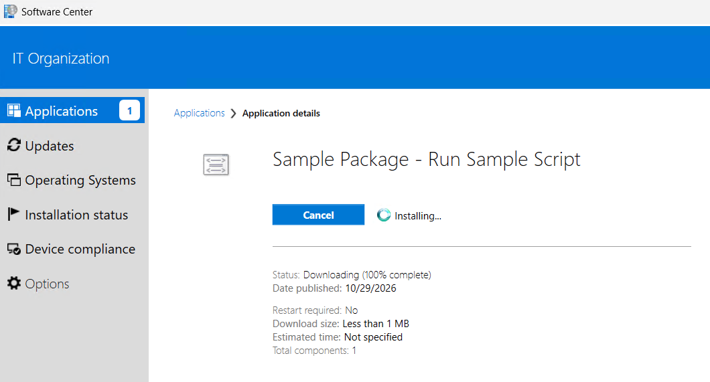

クライアントは必要なコンテンツがキャッシュにあるかを確認し、取得が必要な場合はコンテンツの場所を要求します。CAS.log と LocationServices.log で Package ID とバージョン、返された配布ポイントを確認します。

続いて ContentTransferManager.log で、コンテンツと転送ジョブの対応を確認します。必須展開のクライアントでは、次の記録があります。

```text
CContentTransferManager::DownloadContentEx9 for content PS10009D.1
... (中略) ...
CTMJob({C3880A97-1609-48C8-9643-9315ADECE85E}): CCTMJob::_DownloadContent - DTSJob({CACF34F3-6993-484D-A0F3-C7CB9A470E6C}) started to download from 'http://<SiteServer>/SMS_DP_SMSPKG$/PS10009D' for full content download.
```

利用可能な展開のクライアントでは、別のジョブ ID が記録されています。

```text
CContentTransferManager::DownloadContentEx9 for content PS10009D.1
... (中略) ...
CTMJob({2CA3D0E1-78C5-40E4-A040-C08FB4EC9FD5}): CCTMJob::_DownloadContent - DTSJob({D80123D3-B1D1-4E47-9013-9808F4040F05}) started to download from 'http://<SiteServer>/SMS_DP_SMSPKG$/PS10009D' for full content download.
```

PS10009D.1 は、この例のパッケージとコンテンツ バージョンを対応付ける値です。CTMJob と DTSJob は異なるジョブであるため、ログに記録された対応関係を使用して DataTransferService.log の転送処理へ進みます。

| 実行方法 | ContentTransferManager のジョブ ID | DataTransferService のジョブ ID |
| --- | --- | --- |
| 必須展開 | {C3880A97-1609-48C8-9643-9315ADECE85E} | {CACF34F3-6993-484D-A0F3-C7CB9A470E6C} |
| 手動実行 | {2CA3D0E1-78C5-40E4-A040-C08FB4EC9FD5} | {D80123D3-B1D1-4E47-9013-9808F4040F05} |

それぞれの DataTransferService.log では、対応するジョブが Status : SUCCESS で完了しています。完了通知後の状態変更は、次のメッセージで追跡できます。

必須展開のクライアント:

```text
DTSJob({CACF34F3-6993-484D-A0F3-C7CB9A470E6C}): state changing from 'RetrievedData' to state 'NotifiedComplete'.
```

利用可能な展開のクライアント:

```text
DTSJob({D80123D3-B1D1-4E47-9013-9808F4040F05}): state changing from 'RetrievedData' to state 'NotifiedComplete'.
```

今回の両クライアントでは、取得後の CAS.log に次の対応が記録されています。

```text
Saved Content ID Mapping PS10009D.1, C:\Windows\ccmcache\2
```

必須展開の execmgr.log では、取得要求のハンドルに対応してコンテンツが利用可能になったことも確認できます。

```text
[{AC6A03EF-F184-4F07-8325-F6123594BAC6}]: Content Version 1 is available for advert PS120009, pkg: PS10009D, program Run Sample Script.
```

ダウンロード開始の記録だけでは準備完了を確認できないため、転送結果、キャッシュの対応、および execmgr.log のコンテンツ利用可能の記録を併せて確認します。取得できない場合は、LocationServices.log の取得先、ContentTransferManager.log のジョブ、および対応する DataTransferService.log のエラーを順に確認します。取得先の選択には境界グループと配布ポイントのコンテンツ配置が関係します。

### ステップ 7 : プログラムの実行と結果の確認

ソフトウェア センターから手動実行したクライアントでは、対象プログラムの状態が [Installed] となったことを確認します。次の画面では、操作ボタンも [Reinstall] に変わっています。この画面は利用可能な展開を実行したクライアントの結果です。必須展開の結果は、下記の対応する展開 ID のログで確認します。

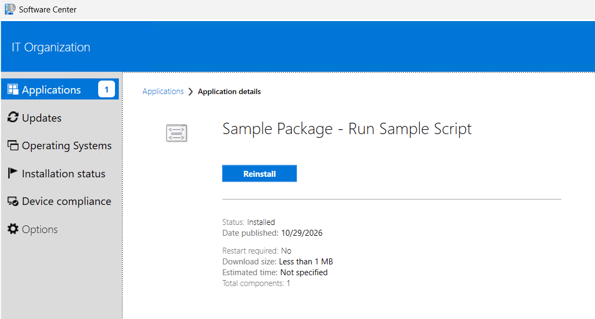

コンテンツと実行条件が揃うと、execmgr.log に実行コンテキスト、コマンド ライン、および作業ディレクトリが記録されます。必須展開のクライアントでは、次のように追跡できます。

```text
Executing program cmd.exe /c SampleScript.cmd in Admin context
... (中略) ...
Command line = "C:\Windows\system32\cmd.exe" /c SampleScript.cmd, Working Directory = C:\Windows\ccmcache\2\
... (中略) ...
Raised Program Started Event for Ad:PS120009, Package:PS10009D, Program: Run Sample Script
... (中略) ...
Program exit code 0
Script for  Package:PS10009D, Program: Run Sample Script succeeded with exit code 0
... (中略) ...
Raised Program Success Event for Ad:PS120009, Package:PS10009D, Program: Run Sample Script
Execution is complete for program Run Sample Script. The exit code is 0, the execution status is Success
```

利用可能な展開のクライアントでも、展開 ID PS12000A に対する実行と成功が記録されています。

```text
Raised Program Started Event for Ad:PS12000A, Package:PS10009D, Program: Run Sample Script
... (中略) ...
Program exit code 0
Script for  Package:PS10009D, Program: Run Sample Script succeeded with exit code 0
... (中略) ...
Raised Program Success Event for Ad:PS12000A, Package:PS10009D, Program: Run Sample Script
Execution is complete for program Run Sample Script. The exit code is 0, the execution status is Success
```

この例では、両方とも終了コード 0 と Success を確認できます。プログラムが開始した記録と、終了・成功の記録を分けて確認することがポイントです。ステータス メッセージの生成状況は StatusAgent.log で確認できます。

パッケージとプログラムでは、アプリケーション モデルの検出方法を使用してインストール済み状態を評価するわけではありません。プログラム自身のログや出力ファイルも確認すると、コマンドの終了結果に加えて、目的の処理が行われたかを確認できます。本記事の抜粋で示している完了範囲は、Configuration Manager によるプログラムの実行と成功の記録です。

実行に失敗した場合は、execmgr.log の実際のコマンド ライン、作業ディレクトリ、実行コンテキスト、終了コードを確認し、プログラム自身のログと照合します。

## 参考リンク

- [パッケージとプログラム](https://learn.microsoft.com/ja-jp/intune/configmgr/apps/deploy-use/packages-and-programs)
- [Understanding package actions](https://learn.microsoft.com/en-us/troubleshoot/mem/configmgr/content-management/understand-package-actions)
- [ログ ファイルのリファレンス](https://learn.microsoft.com/ja-jp/intune/configmgr/core/plan-design/hierarchy/log-files)
- [クライアント キャッシュを構成する](https://learn.microsoft.com/ja-jp/intune/configmgr/core/clients/manage/configure-client-cache)
- [コンテンツ管理のための境界グループの使用](https://learn.microsoft.com/ja-jp/intune/configmgr/core/servers/deploy/configure/boundary-groups-distribution-points)
- [MECM パッケージの再実行の設定方法について解説！](https://jpmem.github.io/blog/mecm/20220421_01/)