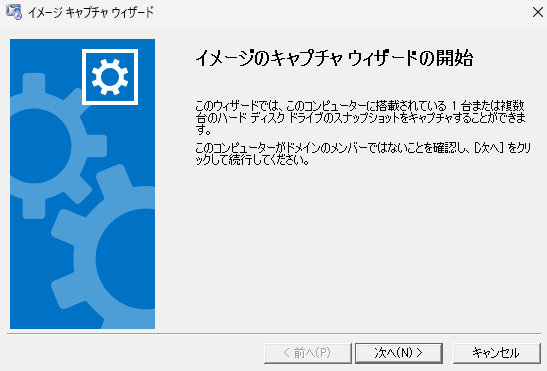
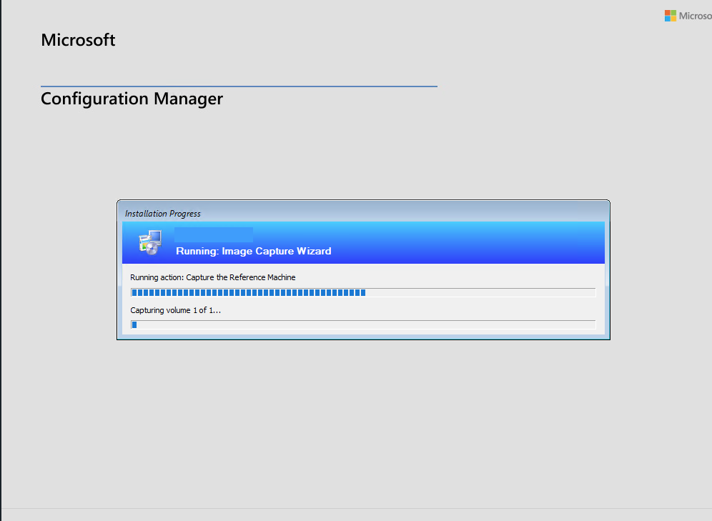
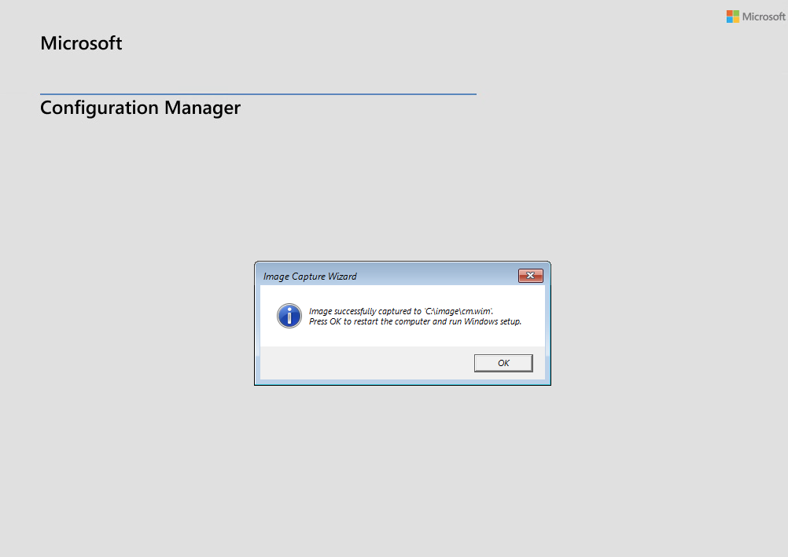

皆様、こんにちは。Configuration Manager / WSUS サポート チームです。

本記事では、Microsoft Configuration Manager でキャプチャ メディアを作成し、参照コンピューターから OS イメージ (.wim) を取得するまでの流れと操作手順をご案内します。あわせて、キャプチャ中に実行される処理と、ログで確認する主なポイントを説明します。

参照コンピューターは、ほかのコンピューターへ展開する Windows のひな形を作るためのコンピューターです。Windows やアプリケーション、設定を展開用の .wim ファイルにまとめる処理を、キャプチャと呼びます。

対象は、参照コンピューターと保存先の準備、キャプチャ メディアの作成、通常起動した Windows (フル OS) 上でのウィザードの実行、および Windows PE でのキャプチャ完了までです。

Windows PE は、OS の展開や保守に使う最小構成の Windows で、本記事ではキャプチャを実行する環境として使用します。

キャプチャした .wim の Configuration Manager への登録、および OS の展開は、本記事の対象外です。また、Windows のインストールからキャプチャまでを自動化する「ビルドとキャプチャ」のタスク シーケンスは扱いません。

## 全体の流れ

作業は、参照コンピューターと保存先の準備、キャプチャ メディアの作成、ウィザードでの保存先の指定、自動処理の完了確認、.wim の回収の順に進めます。参照コンピューターが満たす条件は後述の「参照コンピューターの要件」で、具体的な操作は後述の「キャプチャ メディアの作成から OS イメージ取得までの手順」で説明します。

キャプチャ メディアには、Windows PE を起動するためのブート イメージと、キャプチャに必要な作業を順番に実行するタスク シーケンスが含まれています。メディアを参照コンピューターの Windows 上で実行すると、次の順序で処理されます。

1. キャプチャ メディアの TSMBootstrap を起動し、メディアの構成情報を読み込む
2. Image Capture Wizard で、参照コンピューターがキャプチャの要件を満たしていることを確認し、キャプチャ情報を入力する
3. タスク シーケンス マネージャーを起動し、キャプチャ用のタスク シーケンスを読み込む
4. Configuration Manager クライアントを準備する
5. 参照コンピューターを確認し、起動に必要な情報をバックアップする
6. Windows PE のブート イメージをメディアから取り出す
7. Sysprep で OS を一般化する
8. Windows PE を起動するように構成し、再起動する
9. Windows PE で参照コンピューターのボリュームをキャプチャする
10. キャプチャ完了メッセージを表示し、再起動する

### フル OS と Windows PE の実行環境

キャプチャ用のタスク シーケンスは、Capture the Reference Machine というグループの中に 4 つのステップを持っています。ステップごとの実行環境は、次のとおりです。

タスク シーケンスのステップ | 実行環境 | 本記事のステップ
--- | --- | ---
Prepare Configuration Manager Client | フル OS | ステップ 4
Prepare Operating System | フル OS | ステップ 5 からステップ 8
Capture the Reference Machine | Windows PE | ステップ 9
Show Capture Complete Message | Windows PE とフル OS (コマンド ラインの実行) | ステップ 10

ステップ 8 で Windows PE へ再起動するため、ステップ 1 からステップ 8 までは参照コンピューターの OS 上、ステップ 9 は Windows PE 上で実行されます。

## 動作説明の前提

本記事で説明する動作の条件は、次のとおりです。

項目 | 内容
--- | ---
参照コンピューター | Windows 11 (OS バージョン 10.0.26200.0)。UEFI で、セキュア ブートが有効です。ワークグループで、Configuration Manager クライアントはインストールされていません。
メディア | キャプチャ メディアです。メディアに含まれる Configuration Manager の実行ファイルのバージョンは 5.0.9146.1009 で、ブート イメージ (パッケージ ID PS100002) は x64 です。参照コンピューターには D: ドライブとして接続されています。
実行方法 | キャプチャ メディアを、フル OS 上で実行しています。ログには、メディアの D:\SMS\BIN\x64\TSMBootstrap.exe が /env:FullOS で実行されたことが記録されます。
キャプチャ先 | 参照コンピューター上のローカル パス C:\image\cm.wim です。

## 参照コンピューターの要件

キャプチャ中には、Sysprep (システム準備ツール) が参照コンピューター上で自動的に実行されます。Sysprep は、コンピューター固有の情報を削除し、ほかのコンピューターへ展開できる状態にします。この処理を「一般化」と呼びます。

参照コンピューターは、次の条件を満たした状態でキャプチャしてください。条件のうち、必須のものには (必須) と記載しています。そのほかの条件は、キャプチャを正常に完了するために、満たしておくことを推奨します。

- ボリューム ライセンス サービス センター (VLSC) から入手した Windows のイメージを使用します (必須)。
- 最新の累積的な品質更新プログラムを適用します。Windows 11 のイメージをキャプチャ メディアでキャプチャする場合は、更新プログラムの適用が完了していないと、Sysprep が失敗することがあります。更新プログラムを適用した後は再起動し、新たに適用できる更新プログラムがない状態にします。
- Sysprep の実行時は、組み込みの Administrator アカウント (Built-in Administrator) を使用します。これは、Windows に標準で用意されている Administrator アカウントです。
- OS のアップグレードを行いません。
- ユーザー プロファイルが複数存在しない状態にします。
- ワークグループ環境にします。ドメインに参加していると、キャプチャ用に Windows を準備する処理が失敗します。
- Microsoft Store アプリの追加や、既存の Microsoft Store アプリの更新を行いません。Microsoft Store アプリを追加または更新した状態で Sysprep を実行すると、失敗します。
- Configuration Manager クライアントのインストールは不要です。

詳細は、[Configuration Manager でキャプチャ メディアを使用して Windows 11 イメージをキャプチャするときのエラー](https://learn.microsoft.com/ja-jp/troubleshoot/mem/configmgr/os-deployment/windows-11-image-capture-fail) および [Windows インストールに対する Sysprep (一般化) の実行](https://learn.microsoft.com/ja-jp/windows-hardware/manufacture/desktop/sysprep--generalize--a-windows-installation) をご確認ください。

## キャプチャ メディアの作成から OS イメージ取得までの手順

ここでは、x64 の参照コンピューターに ISO 形式のキャプチャ メディアを接続し、C:\image\cm.wim に保存する例で説明します。作成する ISO はキャプチャ用のツールを含むメディアで、キャプチャの結果として取得する .wim とは別のファイルです。

画面ショットは、仮想マシンのウィンドウ タイトルを除き、ブランド名が表示されている箇所を塗りつぶしています。

### 手順 1 : 参照コンピューターと保存先を準備する

1. 「参照コンピューターの要件」を満たす参照コンピューターに、必要なアプリケーションをインストールし、イメージに含める設定を完了します。
2. システム パーティションが NTFS であることを確認します。参照コンピューターでの操作は、組み込みの Administrator アカウントで実施します。
3. キャプチャ中に Sysprep が OS を一般化するため、元の状態に戻す必要がある場合は、実行前にバックアップや仮想マシンのチェックポイントを取得します。
4. キャプチャ先のフォルダー C:\image を作成し、.wim を保存できる空き容量を確保します。既存の .wim は上書きされるため、必要なファイルが残っている場合は、別の保存先やファイル名を使用します。

ネットワーク共有へ保存する場合は、保存先を `\\fileserver\capture\cm.wim` のように、サーバー名と共有名で始まるパス (UNC パス) で指定します。その共有へ読み取りと書き込みができるアカウントも準備します。Windows PE からも共有へ接続できるように、ネットワーク接続とブート イメージ内のネットワーク ドライバーを確認します。ここで示したサーバー名と共有名は例示です。

### 手順 2 : キャプチャ メディアを作成する

1. x64 など、参照コンピューターの種類に対応するブート イメージを用意し、少なくとも 1 つの配布ポイントへ配布します。本記事の例では x64 のブート イメージを使用します。必要なネットワーク ドライバーとストレージ ドライバーも、ブート イメージに含めておきます。
2. Configuration Manager コンソールを実行するコンピューターで、ISO の出力先フォルダーを作成します。メディアの作成には、このコンピューターの管理者権限と、使用する配布ポイントのコンテンツ ライブラリに対する読み取りアクセス許可が必要です。
3. コンソールで [ソフトウェア ライブラリ] → [オペレーティング システム] → [タスク シーケンス] を開き、[タスク シーケンス メディアの作成] を選択します。
4. 作成するメディアの種類として、キャプチャ用のメディア (Capture media) を選択します。続いて、[CD/DVD セット] を選択します。
5. メディアの容量と、出力先の ISO ファイル名を指定します。例として、C:\CaptureMedia\capture.iso を指定します。既存の ISO を指定すると、次のページへ進んだ時点でそのファイルが削除されるため、新しいファイル名を使用します。
6. ブート イメージと、そのコンテンツを配置した配布ポイントを選択し、ウィザードを完了します。
7. ウィザードが正常に完了し、指定した場所に ISO が作成されていることを確認します。作成に失敗した場合は、コンソールを実行したコンピューターの CreateTSMedia.log を確認します。

USB ドライブへ直接メディアを作成する場合は、[CD/DVD セット] の代わりに [リムーバブル USB ドライブ] を選択します。USB ドライブをフォーマットする場合は、保存されている必要なデータを事前に退避します。メディアは FAT32 ファイル システムを使用するため、4 GB を超えるファイルがコンテンツに含まれる場合は、USB ドライブにメディアを作成できません。これは、作成するキャプチャ メディア側の制限です。

メディア作成の前提と各設定の詳細は、[キャプチャ メディアの作成](https://learn.microsoft.com/ja-jp/intune/configmgr/osd/deploy-use/create-capture-media) をご確認ください。

### 手順 3 : 参照コンピューターの Windows 上でウィザードを起動する

1. 参照コンピューターを通常の Windows で起動し、作成したキャプチャ メディアを接続します。仮想マシンの場合は、仮想 DVD ドライブに ISO を接続します。ここでは、メディアが D: ドライブとして認識されているものとします。
2. エクスプローラーでメディアのドライブ (本記事の例では D:) を開きます。
3. LaunchMedia.cmd をダブルクリックして実行します。コマンドを入力する必要はありません。
4. イメージ キャプチャ ウィザード (英語表記は Image Capture Wizard) が起動し、「イメージのキャプチャ ウィザードの開始」画面が表示されることを確認します。

LaunchMedia.cmd の実行後に表示されるウィザードの開始画面は、次のようになります。



コマンド プロンプトから開始する場合は、管理者権限でコマンド プロンプトを開き、本記事の x64 メディアでは次のコマンドを実行します。ドライブ文字は、実際に接続したメディアに合わせて変更します。

```batch
D:\SMS\BIN\x64\TSMBootstrap.exe /env:FullOS
```

どちらの方法でも、キャプチャ対象の Windows 上でウィザードが開始します。Windows PE への再起動は、後続の処理で自動的に行われます。

### 手順 4 : キャプチャ情報を入力し、処理を開始する

1. イメージ キャプチャ ウィザードの開始画面で、参照コンピューターがドメインに参加していないことを確認し、[次へ] を選択します。このタイミングで、参照コンピューターの要件確認が行われます。
2. 保存先を指定する画面で、.wim の保存先とファイル名を入力します。本記事の例では C:\image\cm.wim です。ネットワーク共有へ保存する場合は、共有のパスと、その共有にアクセスするためのアカウント情報を指定します。
3. イメージ情報の画面で、必要に応じて作成者、バージョン、および説明を入力します。
4. 確認画面で保存先などの設定を確認し、ウィザードを完了してキャプチャ処理を開始します。

以降は、Configuration Manager クライアントの準備、Sysprep による一般化、Windows PE への再起動、およびディスク上の領域 (ボリューム) のキャプチャが自動で進みます。ブート イメージはメディアから参照コンピューターへコピーされるため、処理中はメディアを接続したままにします。

Windows PE で再起動してキャプチャが始まると、次のように進行状況が表示されます。



Capturing volume 1 of 1... は、キャプチャ対象のボリュームが 1 つで、その 1 つ目をキャプチャしていることを示します。

### 手順 5 : キャプチャの完了を確認し、.wim を回収する

1. Windows PE で、手順 4 の画面のように進行状況が表示され、キャプチャが進むことを確認します。
2. Image successfully captured to 'C:\image\cm.wim'. という完了メッセージと、表示された保存先を確認します。  
   
3. [OK] を選択して参照コンピューターを再起動します。OS は一般化されているため、次回起動時には Windows の初回セットアップ (OOBE) が始まります。
4. 参照コンピューター内に保存した場合は、C:\image\cm.wim を別の保管先へコピーします。コピーには、参照コンピューターのディスクを読み取れる環境が必要です。ネットワーク共有へ保存した場合は、その共有上に .wim が作成されていることを確認します。参照コンピューターの復元や再作成は、必要なファイルを回収してから行います。

ここまでで、キャプチャ メディアを使用した OS イメージの取得は完了です。以下では、処理の流れを確認したい場合に参照できるログのポイントを説明します。

## 各ステップとログの追跡方法

### 関連ログ

ログ名 | 保存場所 | 主な用途
--- | --- | ---
smsts.log | 参照コンピューター。本記事のログでは `C:\Users\<ユーザー名>\AppData\Local\Temp\SMSTSLog` | ステップ 1 からステップ 8 (メディアの起動から Windows PE への再起動まで) の実行を確認します。
CreateTSMedia.log | メディアを作成した Configuration Manager コンソールを実行するコンピューター | メディアの作成の詳細を確認します。
Setupact.log / Setuperr.log | 参照コンピューター | Sysprep の詳細を確認します。

Windows PE で実行されるステップ 9 とステップ 10 の smsts.log は掲載せず、手順 4 と手順 5 の画面と公開情報で説明しています。

ログ抜粋は、smsts.log から説明に必要な行だけを抜き出したもので、各行の日時、スレッド ID、ソース ファイル名などの付加情報は省いています。行を省略した箇所は `...` で示し、どの処理の記録かを区別できるよう、先頭に `[TSManager]` のようなコンポーネント名を付けています。展開 ID、スコープ GUID、およびボリューム ID は、対応関係を保ったまま `<展開 ID>`、`<スコープ GUID>`、`<ボリューム ID>` に匿名化しています。

### ログで確認する名前と保存先

ログを追跡するときの手掛かりは、次のとおりです。

項目 | 値
--- | ---
タスク シーケンス名 | Image Capture Wizard
タスク シーケンスのパッケージ ID | INMEM_TS
ブート イメージのパッケージ ID | PS100002
キャプチャ先 (OSDCaptureDestination) | C:\image\cm.wim

### ステップ 1 : キャプチャ メディアの TSMBootstrap を起動し、メディアの構成情報を読み込む

メディアの D:\SMS\BIN\x64\TSMBootstrap.exe が /env:FullOS で実行され、通常の Windows 上でキャプチャの準備が始まります。続いて、メディア内の variables.dat から設定情報を、Policy.xml から実行する手順の情報を読み込みます。この例では、必要な情報とブート イメージ (PS100002) をメディア内から取得しています。

```text
[TSMBootstrap]  ==============================[ TSMBootStrap.exe ]==============================
[TSMBootstrap]  Command line: TSMBootstrap.exe /env:FullOS
[TSMBootstrap]  Current OS version is 10.0.26200.0
[TSMBootstrap]  In full OS starting tsmbootstrap.exe version 5.0.9146.1009 from location 'D:\SMS\BIN\x64\TSMBootstrap.exe'
[TSMBootstrap]  Media Root = D:\
[TSMBootstrap]  Executing from Media in Full OS
[TSMBootstrap]  MediaType = FullMedia
[TSMBootstrap]  Loading Media Variables from "D:\sms\data\variables.dat"
[TSMBootstrap]  UEFI: true
[TSMBootstrap]  SecureBootState: Enabled
[TSMBootstrap]  Loading policy from D:\sms\data\Policy.XML.
...
[TSMBootstrap]  Getting policy for CCM_SoftwareDistribution[AdvertID="{<展開 ID>}", PackageID="PS100002", ProgramID="*"]
...
[TSMBootstrap]  PS100002 content location: file:VOL001:\SMS\PKG\PS100002
```

成功の目安は、Executing from Media in Full OS とブート イメージの content location が記録され、ステップ 2 で OsdCaptureCD.exe が起動することです。失敗時は、メディアを参照コンピューターから読み取れることを確認します。メディアの作成結果は、CreateTSMedia.log で確認できます。

### ステップ 2 : Image Capture Wizard で要件を確認し、キャプチャ情報を入力する

TSMBootstrap は、メディアの内容を C:\_SMSTaskSequence へコピーした後、OsdCaptureCD.exe (画面に表示される Image Capture Wizard) を起動します。

ウィザードは、[次へ] が選択されたタイミングで、参照コンピューターが次の要件を満たしているかを確認します。

- ドメイン コントローラーではないこと
- システム パーティションが NTFS であること
- 展開に必要なツールが存在すること
- ドメインに参加していないこと

その後、入力した保存先などを保存します。ログでは、キャプチャ先が OSDCaptureDestination として記録されます。

```text
[TSMBootstrap]  copying files from d:\ to C:\_SMSTaskSequence
[TSMBootstrap]  Set command line: OsdCaptureCD.exe
[OSDCaptureCD]  ==============================[ OsdCaptureCD.exe ]==============================
[OSDCaptureCD]  Running module version 5.0.9146.1009 from location 'D:\SMS\BIN\x64\OsdCaptureCD.exe'
[OSDCaptureCD]  Activating Welcome Page.
[OSDCaptureCD]  WelcomePage::OnWizardNext()
[OSDCaptureCD]  Verifying that this machine meets the capture requirements.
[OSDCaptureCD]  Local machine is not a domain controller.
[OSDCaptureCD]  System partition is NTFS
[OSDCaptureCD]  Verified deploy tools are present.
[OSDCaptureCD]  Local machine is not part of a domain
[OSDCaptureCD]  Activating Destination Page.
[OSDCaptureCD]  DestinationPage::OnWizardNext()
[OSDCaptureCD]  Activating Welcome Page.
[OSDCaptureCD]  InfoPage::OnWizardNext()
[OSDCaptureCD]  Activating Finish Page.
[OSDCaptureCD]  Saving capture information in the environment.
[OSDCaptureCD]  Adding OSDCaptureDestination to the path migration list.
[OSDCaptureCD]  Exiting with return code 0x00000000
[TSMBootstrap]  Process completed with exit code 0
```

成功の目安は、4 つの確認結果が上記のように記録され、OsdCaptureCD が Exiting with return code 0x00000000 で終了することです。失敗時は、4 つの確認結果と、参照コンピューターがワークグループであることをご確認ください。

### ステップ 3 : タスク シーケンス マネージャーを起動し、タスク シーケンスを読み込む

TSMBootstrap は、処理の実行を管理するタスク シーケンス マネージャー (TSManager) を起動します。TSManager は、キャプチャ用のタスク シーケンス (名前は Image Capture Wizard、ID は INMEM_TS) を読み込み、Capture the Reference Machine グループの 4 つのステップと、各ステップを通常の Windows と Windows PE のどちらで実行するかを記録します。

```text
[TSMBootstrap]  Creating the Task Sequence Manager Service.
[TSMBootstrap]  Starting Task Sequence Manager Service.
[TSManager]  Commandline: "C:\_SMSTaskSequence\sms\bin\x64\TsManager.exe" /service /noclient /loghandle 1876 544
[TSManager]  NOT executing in WinPE
[TSManager]  TSManager initialized environment for task sequence: deployment ID = '{<展開 ID>}', package ID = 'INMEM_TS', Name = 'Image Capture Wizard'
[TSManager]  There are 1 first level steps or groups
[TSManager]  Parsing group node: Capture the Reference Machine
[TSManager]  There are 4 first level steps or groups
[TSManager]  Parsing step node: Prepare Configuration Manager Client
[TSManager]  Run in attribute: FullOS
[TSManager]  Parsing step node: Prepare Operating System
[TSManager]  Run in attribute: FullOS
[TSManager]  Parsing step node: Capture the Reference Machine
[TSManager]  Run in attribute: WinPE
[TSManager]  Parsing step node: Show Capture Complete Message
[TSManager]  Run in attribute: WinPEandFullOS
...
[TSManager]  Do not send status message in full media case
[TSManager]  Start executing an instruction. Instruction name: 'Capture the Reference Machine'.  Pointer: 0. Type: ''. Disabled: 0
[TSManager]  The group (Capture the Reference Machine) has been successfully started
```

成功の目安は、The group (Capture the Reference Machine) has been successfully started が記録されることです。

### ステップ 4 : Configuration Manager クライアントを準備する

最初のステップ Prepare Configuration Manager Client では、osdpreparesmsclient.exe が、参照コンピューター上の Configuration Manager クライアントを削除または構成して、キャプチャできる状態にします。このログは、参照コンピューターに Configuration Manager クライアントがインストールされていない場合のものです。

```text
[TSManager]  Start executing an instruction. Instruction name: 'Prepare Configuration Manager Client'.  Pointer: 1. Type: 'SMS_TaskSequence_PrepareSMSClientAction'. Disabled: 0
[TSManager]  Start executing the command line: osdpreparesmsclient.exe
[PrepareSMSClient]  Running module version 5.0.9146.1009 from location 'C:\_SMSTaskSequence\sms\bin\x64\osdpreparesmsclient.exe'
...
[PrepareSMSClient]  This computer does not have SMS site server installed
[PrepareSMSClient]  SMS Client is not installed on this machine.
[PrepareSMSClient]  Successfully opened client certificate store.
[PrepareSMSClient]  No certificates to delete
[PrepareSMSClient]  No client configuration file found.
[PrepareSMSClient]  Deleting 'smstsmgr' service from SCM database..
[PrepareSMSClient]  'smstsmgr' service successfully deleted from SCM database
[TSManager]  Process completed with exit code 0
[TSManager]  Successfully completed the action (Prepare Configuration Manager Client) with the exit win32 code 0
```

成功の目安は、Successfully completed the action (Prepare Configuration Manager Client) with the exit win32 code 0 です。失敗時は、PrepareSMSClient の行をご確認ください。

### ステップ 5 : 参照コンピューターを確認し、起動に必要な情報をバックアップする

次のステップ Prepare Operating System では、osdprepareos.exe が Sysprep を実行し、Windows PE へ再起動する準備を進めます。ステップ 5 からステップ 8 が、この処理に対応します。

最初に、Windows の起動に必要なファイルと、起動先などを管理する構成情報 (BCD) をバックアップします。続いて、ステップ 2 と同じ 4 つの要件を再確認し、一時ファイルを削除します。

```text
[TSManager]  Start executing an instruction. Instruction name: 'Prepare Operating System'.  Pointer: 2. Type: 'SMS_TaskSequence_PrepareOSAction'. Disabled: 0
[TSManager]  Start executing the command line: osdprepareos.exe /activate:%OSDKeepActivation% /bmsd:%OSDBuildStorageDriverList% /shutdown:%OSDShutdownPreparedOs%
[PrepareOS]  Command line: "osdprepareos.exe" /activate:false /bmsd:false /shutdown:false
[PrepareOS]  Backing up existing boot system.
...
[PrepareOS]  BackupEfiBoot: Z:\, C:\_SMSTaskSequence\backup-EFI
[PrepareOS]  Failed to copy Z:\EFI\Microsoft\Boot\BCD to C:\_SMSTaskSequence\backup-EFI\EFI\Microsoft\Boot\BCD. 0x80070020
[PrepareOS]  Failed to copy Z:\EFI\Microsoft\Boot\BCD.LOG to C:\_SMSTaskSequence\backup-EFI\EFI\Microsoft\Boot\BCD.LOG. 0x80070020
...
[PrepareOS]  BcdBackup: C:\_SMSTaskSequence\BCD-EFI\bcd
[PrepareOS]  Set command line: "bcdedit.exe" /export C:\_SMSTaskSequence\BCD-EFI\bcd
[PrepareOS]  Process completed with exit code 0
[PrepareOS]  Local machine is not a domain controller.
[PrepareOS]  System partition is NTFS
[PrepareOS]  Verified deploy tools are present.
[PrepareOS]  Local machine is not part of a domain
[PrepareOS]  Emptying Recycle bin..
[PrepareOS]  SHEmptyRecycleBin failed, hr=8000ffff
[PrepareOS]  Emptying Recycle bin failed, hr=8000ffff
[PrepareOS]  Successfully deleted contents of directory 'C:\WINDOWS\temp'
```

このログには、BCD のコピーやごみ箱を空にする処理の失敗が記録されていますが、続く bcdedit.exe /export は正常に終了し、ステップ全体も成功しています (ステップ 7 の末尾を参照)。

### ステップ 6 : Windows PE のブート イメージをメディアから取り出す

osdprepareos.exe は、Windows PE で起動するためのブート イメージを、参照コンピューターのローカル ディスクへ配置します。このログでは、ブート イメージ (PS100002) が C:\_SMSTaskSequence\WinPE\sources\boot.wim にないため、D: のメディアの SMS\PKG\PS100002\boot.PS100002.wim からコピーし、ブート ファイルを展開しています。

```text
[PrepareOS]  Staging boot image PS100002
[PrepareOS]  Checking to see if the data path is on a bootable volume
[PrepareOS]  Boot Image not found in local data cache at 'C:\_SMSTaskSequence\WinPE\sources\boot.wim'. Staging is required
[PrepareOS]  Package location: _SMSTSPS100002, file:VOL001:\SMS\PKG\PS100002
[PrepareOS]  Searching C:\ for Fullmedia content
[PrepareOS]  Searching D:\ for Fullmedia content
[PrepareOS]  Found Fullmedia content in drive D:\.
[PrepareOS]  Found boot image D:\SMS\PKG\PS100002\boot.PS100002.wim
[PrepareOS]  Copying boot image from 'D:\SMS\PKG\PS100002\boot.PS100002.wim' to local destination 'C:\_SMSTaskSequence\WinPE\sources\boot.wim'...
...
[PrepareOS]  Opening image file C:\_SMSTaskSequence\WinPE\sources\boot.wim
[PrepareOS]  Extracting boot files from boot image of architecture 9 on computer system of architecture 9
[PrepareOS]  Applying image 1
...
[PrepareOS]  Closing image file C:\_SMSTaskSequence\WinPE\sources\boot.wim
[PrepareOS]  Capturing WinPE bootstrap settings
...
[PrepareOS]  Pre-staging of WINPE image successful
```

続いて、ネットワーク設定を取得する osdnetsettings.exe が実行されます。このログの参照コンピューターでは物理ネットワーク アダプターが見つからず、正常終了しています。

```text
[PrepareOS]  Set command line: "osdnetsettings.exe" capture adapters:true scope:Global\{<スコープ GUID>}
[OSDNetSettings]  No physical network adapters found
[OSDNetSettings]  OSDNetSettings finished: 0x00000000
```

成功の目安は、Pre-staging of WINPE image successful です。このログではブート イメージをメディアから取得するため、この時点でメディアを接続しておく必要があります。失敗時は、Found boot image の行、メディアの接続状態、およびブート イメージが参照コンピューターの種類 (x64 など) に対応していることをご確認ください。

### ステップ 7 : Sysprep で OS を一般化する

osdprepareos.exe は、コンピューター証明書を削除した後、Sysprep を /quiet /generalize /oobe /quit で実行します。/generalize はコンピューター固有の情報を削除し、/oobe は次回起動時に Windows の初回セットアップ (OOBE) を表示するようにし、/quit は Sysprep の完了後に再起動やシャットダウンを行いません。

```text
[PrepareOS]  Opening Certificate store my ok.
[PrepareOS]  No Machine Certificates to delete
[PrepareOS]  Deleting Machine Certificates succeeded
[PrepareOS]  Executing 'C:\WINDOWS\system32\sysprep\sysprep.exe /quiet /generalize /oobe /quit' ...
[PrepareOS]  Sysprep will run using this command line 'C:\WINDOWS\system32\sysprep\sysprep.exe /quiet /generalize /oobe /quit'
[PrepareOS]  Admin 'Administrator' is logged on, running Sysprep under the admin account.
[PrepareOS]  Sysprep is being executed using admin account token.
[PrepareOS]  Failed to show task sequence progress dialog. Error code 0x8001010e
[TSProgressUI.exe]  Starting ProgressDlg::OnInitDialog()
...
[PrepareOS]  Sysprep state set to IMAGE_STATE_GENERALIZE_RESEAL_TO_OOBE
[PrepareOS]  Sysprep.exe has marked the OS as generalized for deployment.
[PrepareOS]  Sysprep finished successfully
[PrepareOS]  Sysprep'ing the machine successful
[PrepareOS]  Exiting with error code 0
[TSManager]  Process completed with exit code 0
[TSManager]  Successfully completed the action (Prepare Operating System) with the exit win32 code 0
```

Sysprep の実行中は、TSProgressUI.exe の Starting ProgressDlg::OnInitDialog() が繰り返し記録されますが、その後に Sysprep は正常に完了しています。

成功の目安は、Sysprep.exe has marked the OS as generalized for deployment. と Sysprep finished successfully、およびステップの終了を示す Successfully completed the action (Prepare Operating System) with the exit win32 code 0 です。失敗時は、PrepareOS の Sysprep の行に加えて、参照コンピューターの Setupact.log と Setuperr.log をご確認ください。

### ステップ 8 : Windows PE を起動するように構成し、再起動する

Sysprep の完了後、TSManager は Reboot to WinPE を記録し、次回は Windows PE で起動するように Windows の起動設定 (BCD) を変更します。このとき、キャプチャ先などのパスに含まれるドライブ文字 (C: など) が、ディスク上の領域を識別する値 (ボリューム ID) に置き換わります。ログの例では C:\image\cm.wim が <ボリューム ID>:\image\cm.wim になりますが、保存先を入力し直す必要はありません。その後、TSManager が再起動を要求します。

```text
[TSManager]  Reboot to WinPE
[TSManager]  Created volatile registry entry for pending reboot initiated by this task sequence
[TSManager]  Calling RebootSystem()
[TSManager]  Staging boot image PS100002
...
[TSManager]  Boot image already staged locally
[TSManager]  Installing boot image to hard drive
[TSManager]  This is boot image of architecture 9 on UEFI system of architecture 9
[TSManager]      Setting up new boot system
[TSManager]  BootSystemBcdEfi::loadSource
[TSManager]  Successfully loaded a source EFI BCD boot system
[TSManager]  Adding BCD entry for C:\_SMSTaskSequence\WinPE\sources\boot.wim
...
[TSManager]  BootLoader::restore: C:\_SMSTaskSequence\WinPE, Z:\
[TSManager]  Saving bcd store to C:\_SMSTaskSequence\WinPE\boot\BCD
...
[TSManager]  Path variable OSDCaptureDestination converted from C:\image\cm.wim to <ボリューム ID>:\image\cm.wim
[TSManager]  Path variable OSDTargetSystemRoot converted from C:\WINDOWS to <ボリューム ID>:\WINDOWS
[TSManager]  Path variable OSDTargetSystemDrive converted from C: to <ボリューム ID>:
...
[TSManager]  _SMSTSCaptureMedia variable set to true
[TSManager]  InitiateSystemReboot() is attempting to reboot the system
[TSManager]  The system will reboot in 0 seconds.
[TSManager]  The action (Prepare Operating System) initiated a reboot request
...
[TSManager]  Execution engine result code: Reboot (2)
[TSManager]  Task Sequence Manager execution terminated as system shutdown is in progress. Code 0x00000000
```

成功の目安は、Adding BCD entry for C:\_SMSTaskSequence\WinPE\sources\boot.wim と Saving bcd store の記録、および Execution engine result code: Reboot (2) です。この例の Reboot (2) は、Windows PE へ切り替えるための再起動を示しており、エラーではありません。再起動後は、参照コンピューターが Windows PE で起動します。失敗時は、Installing boot image to hard drive から Saving bcd store までの行と、参照コンピューターの起動に関する設定 (UEFI、セキュア ブート) をご確認ください。

### ステップ 9 : Windows PE で参照コンピューターのボリュームをキャプチャする

Windows PE で起動すると、ステップ Capture the Reference Machine が実行されます。進行状況の画面は、手順 4 に掲載しています。

このステップでは、次の条件で OS イメージを取得します。

- Windows PE でのみ実行され、指定した場所に Windows イメージ (.wim) ファイルを作成します。既存の .wim ファイルは上書きされます。
- ボリュームごとに、.wim ファイル内の個別のイメージとしてキャプチャします。対象は、NTFS または FAT32 でフォーマットされたボリュームだけです。
- OS がインストールされているボリュームとブート ボリュームは、同じボリュームである必要があります。
- キャプチャ先にネットワーク共有を指定する場合は、その共有への読み取りと書き込みのアクセス許可を持つ、キャプチャ OS イメージ アカウントが必要です。

本記事の例のキャプチャ先は、ステップ 2 で保存された C:\image\cm.wim です。このステップは Windows PE で実行されるため、smsts.log は掲載していません。

### ステップ 10 : キャプチャ完了メッセージを表示し、再起動する

最後のステップ Show Capture Complete Message は、完了メッセージを表示するコマンドを実行します (ステップ 3 のログでは、Windows PE とフル OS の両方で実行する設定です)。メッセージの画面は手順 5 に掲載しています。表示される保存先は、ステップ 2 でウィザードに入力した C:\image\cm.wim で、[OK] を選択すると再起動します。

キャプチャした .wim は、[オペレーティング システム イメージ パッケージの追加] ウィザードで Configuration Manager に登録し、別のコンピューターへの OS 展開で使用できます。

## ログ確認のポイント

### 実行結果を判断する行

確認する内容 | smsts.log に記録される行
--- | ---
ステップの開始 | Start executing an instruction. Instruction name: '<ステップ名>'.  Pointer: <実行位置>.
ステップの正常終了 | Successfully completed the action (<ステップ名>) with the exit win32 code 0
再起動による中断 | Execution engine result code: Reboot (2)
サイトへの実行状況の通知 | Do not send status message in full media case

### 警告やエラーに見える行

smsts.log には、警告やエラーとして記録された行が含まれます。本記事のログには次のような行がありますが、その後にステップが正常に終了し、後続の処理へ進んでいます。

- Failed to copy Z:\EFI\Microsoft\Boot\BCD ... 0x80070020 (ステップ 5)
- SHEmptyRecycleBin failed, hr=8000ffff (ステップ 5)
- Failed to show task sequence progress dialog. Error code 0x8001010e (ステップ 7)
- Cannot find NAAConfig CCM_NetworkAccessAccount (ステップ 1)

こうした行がある場合も、後続の処理とステップの終了結果をあわせて確認します。ステップの正常終了を確認する目安は、Successfully completed the action の行です。

### 失敗したときに確認する箇所

症状 | 確認する箇所
--- | ---
ウィザードで要件を満たさないと判断される | OsdCaptureCD の 4 つの確認結果。参照コンピューターがドメインに参加していないこと、システム パーティションが NTFS であること。
Prepare Operating System で失敗する | PrepareOS の Sysprep の行、および参照コンピューターの Setupact.log と Setuperr.log。
ブート イメージを取得できない | Found boot image の行。メディアが接続されていること。
Windows PE で起動しない | Installing boot image to hard drive から Saving bcd store までの行。UEFI やセキュア ブートなど、起動に関する設定。
キャプチャが完了しない | Windows PE の smsts.log。キャプチャ先のパスと、ネットワーク共有の場合は、キャプチャ OS イメージ アカウントのアクセス許可。ボリュームの形式 (NTFS または FAT32)。

## 留意事項

- OS イメージをキャプチャするたびに、新しい参照コンピューターを用意します。同じ参照コンピューターを再利用する場合に必要な対応は、[OS をキャプチャするタスク シーケンスの作成](https://learn.microsoft.com/ja-jp/intune/configmgr/osd/deploy-use/create-a-task-sequence-to-capture-an-operating-system#example-task-sequence) をご確認ください。
- 異なるモデルのデバイスへの展開時に、ドライバーに起因する問題を避けるため、カスタマイズした OS イメージは仮想マシンで作成することが推奨されています。

## 参考リンク

- [キャプチャ メディアの作成](https://learn.microsoft.com/ja-jp/intune/configmgr/osd/deploy-use/create-capture-media)
- [タスク シーケンス メディアの作成](https://learn.microsoft.com/ja-jp/intune/configmgr/osd/deploy-use/create-task-sequence-media)
- [OS をキャプチャするタスク シーケンスの作成](https://learn.microsoft.com/ja-jp/intune/configmgr/osd/deploy-use/create-a-task-sequence-to-capture-an-operating-system)
- [Configuration Manager でキャプチャ メディアを使用して Windows 11 イメージをキャプチャするときのエラー](https://learn.microsoft.com/ja-jp/troubleshoot/mem/configmgr/os-deployment/windows-11-image-capture-fail)
- [タスク シーケンスの手順](https://learn.microsoft.com/ja-jp/intune/configmgr/osd/understand/task-sequence-steps)
- [Configuration Manager で使用するアカウント](https://learn.microsoft.com/ja-jp/intune/configmgr/core/plan-design/hierarchy/accounts)
- [ログ ファイルのリファレンス](https://learn.microsoft.com/ja-jp/intune/configmgr/core/plan-design/hierarchy/log-files)
- [Windows PE (WinPE)](https://learn.microsoft.com/ja-jp/windows-hardware/manufacture/desktop/winpe-intro?view=windows-11)
- [Sysprep コマンド ライン オプション](https://learn.microsoft.com/ja-jp/windows-hardware/manufacture/desktop/sysprep-command-line-options)
- [Windows インストールに対する Sysprep (一般化) の実行](https://learn.microsoft.com/ja-jp/windows-hardware/manufacture/desktop/sysprep--generalize--a-windows-installation)
